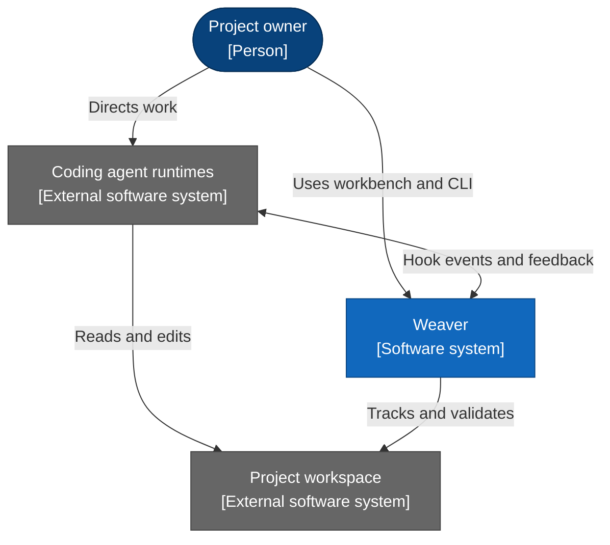
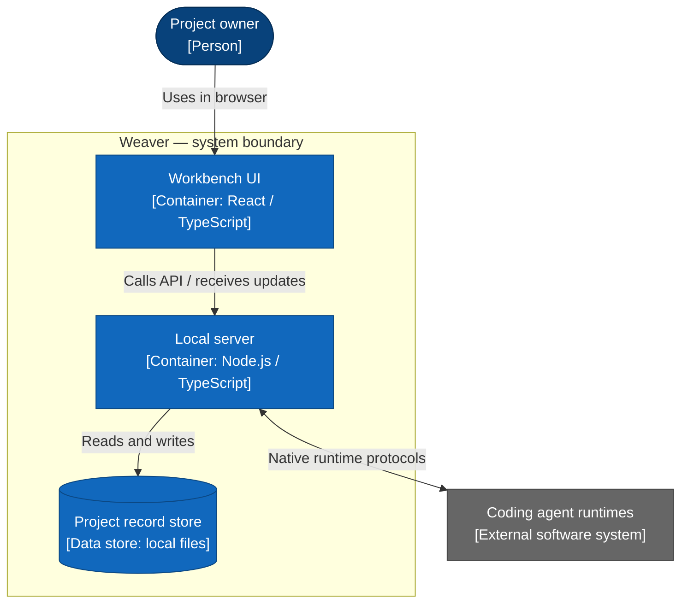
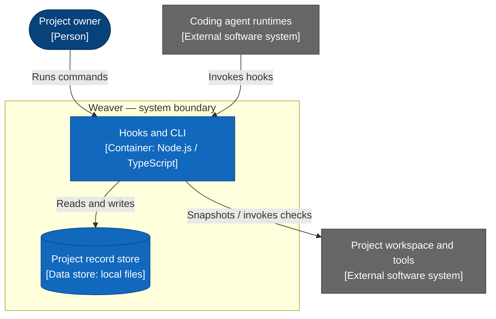
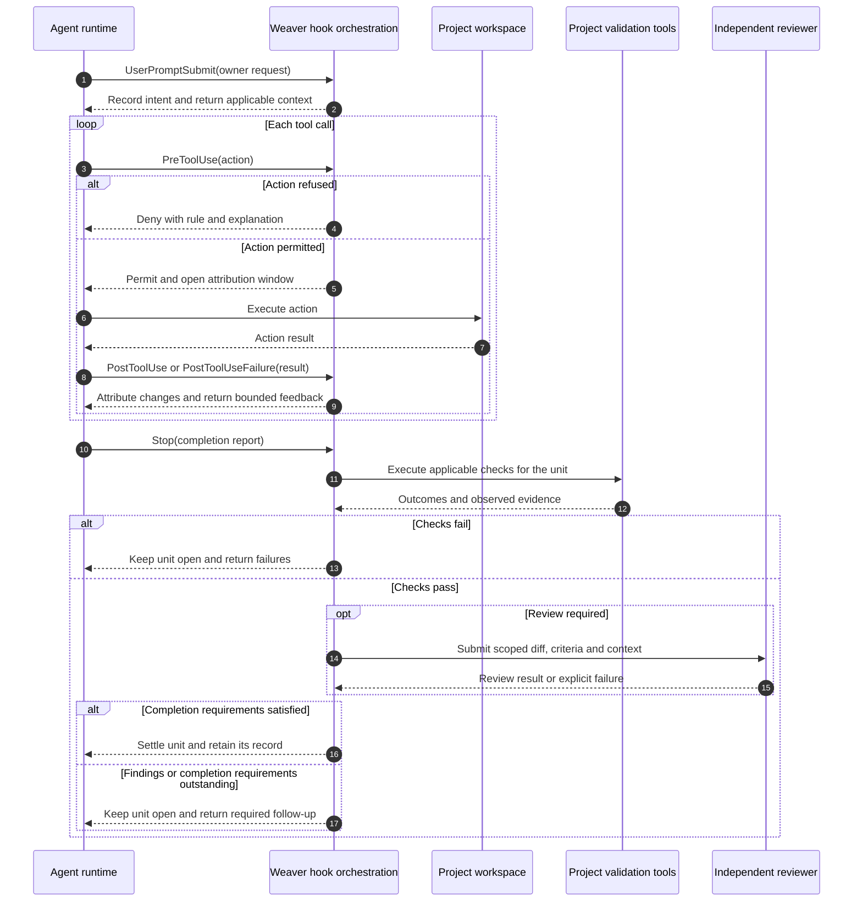

Weaver is a local development workbench for coding agents. It brings permissions, change tracking, automated checks, independent reviews, and project memory into one place, keeping you in control from the first action to the final diff.

This repository is the development environment for building Weaver as an independent application from an existing repository harness.

## Project status

Weaver is in the planning stage. No engine has been extracted yet, and there is no runnable application or installation procedure in this repository.

The reference harness remains operational while Weaver is developed separately. A consuming project will adopt a selected version only after its integration and historical data preservation have been validated.

## Responsibilities

Weaver is organized around six responsibilities. These are architectural boundaries to establish, not a description of modules already implemented here.

| Responsibility                 | Purpose                                                                                                                  |
|--------------------------------|--------------------------------------------------------------------------------------------------------------------------|
| Agent action control           | Identify the actor, interpret actions, evaluate permissions and explain refusals.                                        |
| Session tracking               | Retain owner requests, attribute changes to sessions and maintain snapshots and units of work.                           |
| Validation and task completion | Run configured checks, coordinate independent reviews, handle findings and determine whether a unit can finish.          |
| Harness memory                 | Retain signals, sources, decisions and evidence; structure items and retrieve qualified context under explicit policies. |
| Workbench                      | Provide the local interface for memory, workspace information and conversations with Codex and Claude.                   |
| Storage                        | Provide durable records, transactions, locking, content preservation and explicit migrations.                            |

Storage supports the other responsibilities without defining their business rules. Hooks, the CLI and HTTP endpoints adapt external interactions to domain operations. Orchestration coordinates those operations without becoming another place to define their rules.

## System context

Scope: Weaver as one software system. This view identifies its users and external systems; it intentionally omits internal modules and implementation technologies.

The static views use C4 element types and boundaries with Mermaid's automatic flowchart layout. Blue elements belong to Weaver; grey elements are external. Arrows name interactions, and a double-headed arrow represents a bidirectional exchange. These views remain proposed architecture.

## Runtime structure

Scope: the proposed executables, browser application and data store within Weaver. A C4 container is an application or data store, not a Docker container. The six responsibility boundaries above describe modules inside these executables; they are not six services.

The container view is split into two focused views to keep relationships readable. The record store and native runtimes shown in both views are the same elements, not separate installations.

### Workbench and conversations

### Hooks, CLI and project validation

| Relationship                                                | Interface and responsibility                                                                                    |
|-------------------------------------------------------------|-----------------------------------------------------------------------------------------------------------------|
| UI to local server                                          | HTTP requests and SSE updates over loopback; presentation invokes domain operations.                            |
| Local server to agent runtimes                              | Native provider protocols for sending messages, streaming, interruption and resumption.                         |
| Agent runtimes to hooks                                     | Process invocation with JSON event input; decisions and feedback are returned through the hook protocol.        |
| Owner to CLI                                                | Terminal invocation with owner/agent authority checks.                                                          |
| Hooks to project workspace                                  | Filesystem inspection and configured child processes for validation.                                            |
| Server to project workspace, omitted from the focused views | Reads workspace metadata and repository workflows.                                                              |
| Executables to record store                                 | Domain-owned persistence through shared durability primitives; local JSONL records and content-addressed blobs. |

The hook/CLI executables and local server share domain code rather than communicating through an additional engine service. The record store is logically managed by Weaver, but its contents belong to the consuming project. Its physical location and installation strategy remain design decisions.

## Unit lifecycle — UML sequence

Scope: one supervised unit, showing ordered calls and responses. Solid arrows denote calls or notifications; dashed arrows denote responses. `loop`, `alt` and `opt` fragments express repetition, alternatives and optional review. This view omits storage calls and provider-specific protocol details.

A review failure is retained explicitly and never represented as a clean review. Its effect on settlement is defined by the completion policy. Correction and finding-answer rounds repeat the relevant lifecycle steps.

## Weaver and its projects

Weaver owns the mechanisms. Each project owns its requirements, validation tools, integration settings and retained data.

| Weaver owns                                                   | The project owns                                                                |
|---------------------------------------------------------------|---------------------------------------------------------------------------------|
| Policy evaluation and enforcement mechanisms                  | Enabled restrictions, protected paths and project-specific exceptions           |
| Session attribution and snapshot mechanisms                   | Repository scopes and actual session records                                    |
| Check scheduling, execution observation and review lifecycle  | Check commands, thresholds, review criteria and development-stack configuration |
| Memory schemas, lifecycle operations and retrieval mechanisms | Items, sources, labels, evidence and owner decisions                            |
| Workbench and native agent connectors                         | Local conversations and repository workflows                                    |
| Storage and migration mechanisms                              | Historical records and backups                                                  |

Frontend rules, backend linters, migration tools, development stacks and contribution conventions remain with their consuming projects. A file protected by Weaver remains owned by the project when its contents express project policy.

Project integration must declare these requirements explicitly. Weaver must build and run without relying on a particular project's directory layout, a sibling checkout or that project's installed dependencies.

Diagram conventions follow the [C4 model](https://c4model.com/diagrams) for static architecture views and UML sequence notation for the lifecycle. The C4 views are rendered with Mermaid's [flowchart syntax](https://mermaid.js.org/syntax/flowchart.html), with explicit element types and system boundaries; the lifecycle uses its [sequence syntax](https://mermaid.js.org/syntax/sequenceDiagram.html). This avoids the fixed placement of Mermaid's experimental C4 renderer.

## Development principles

- Keep domain boundaries explicit and access another domain through its public operations.
- Share domain operations across hooks, the CLI and the workbench rather than implementing different behavior for each entry point.
- Define observable behavior through its trigger, inputs, effects, outputs, failure handling and resource budget.
- Distinguish preserved behavior from intentional changes; restructuring must not silently change how agents are supervised.
- Keep recorded statements, observed execution and verified conclusions distinguishable.
- Preserve historical identifiers, sources, outcomes and evidence during extraction and migration.
- Bound resource use and make waits, interruptions and failures understandable.
- Start with a modular application; separate services and a general plugin system are not prerequisites for extraction.

## Extraction approach

1. Establish a source reference and inventory existing behavior and project dependencies.
2. Create an isolated development baseline with self-contained tooling and tests.
3. Define the project integration contracts and separate project-specific policy and validation from the engine.
4. Restructure the engine around the responsibility boundaries, validating behavior at each step.
5. Validate historical data preservation, project integration and native agent lifecycle behavior.
6. Prepare a pinned installation, a verified data backup and a rollback procedure before activating Weaver in a consuming project.

The development copy must not write to a project's live harness state alongside its operational harness. Tests use isolated repositories and explicit copies of retained data. Historical project data, credentials and private conversation transcripts do not belong in Weaver's version-controlled sources.

Replacing the engine and migrating its data are separate operations. Removal of an embedded harness happens only after the external replacement is operational and the transition has been verified.
