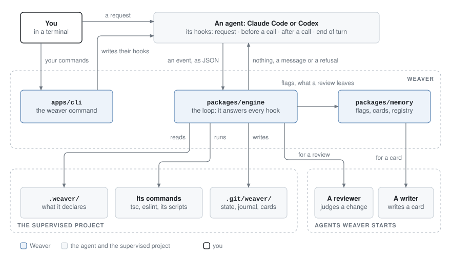
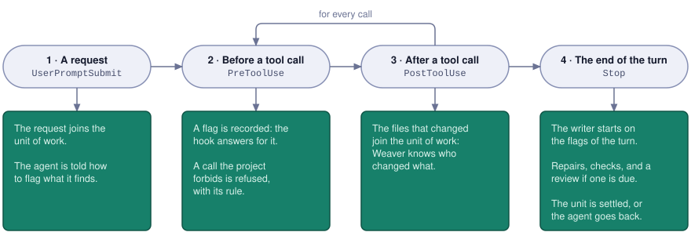
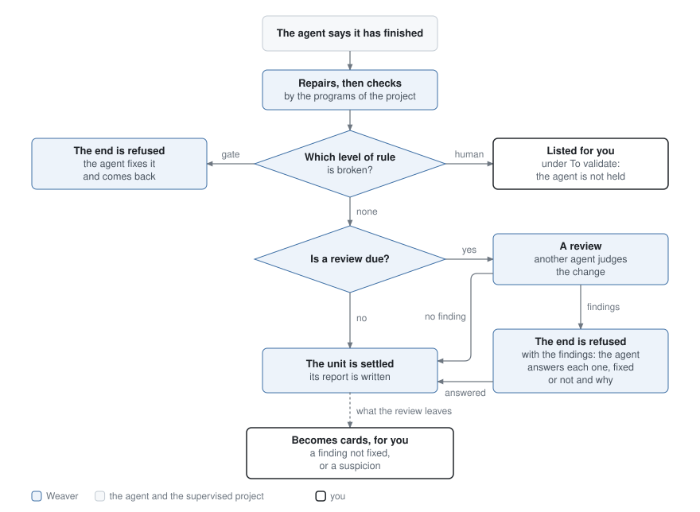
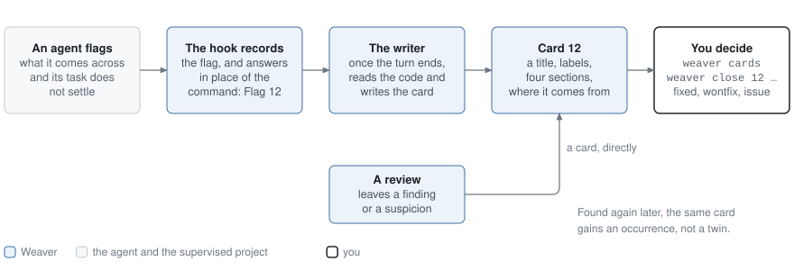
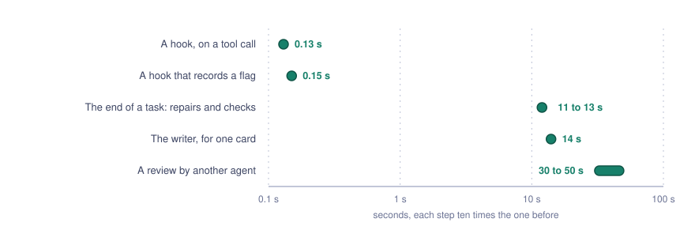

Weaver supervises the coding agents that work in a repository. It plugs into the hooks of Claude Code and Codex. From there it knows which files each agent changed, refuses what the project forbids, runs the project's own checks when a task ends, has another agent review the change, and keeps what agents discover along the way for you to decide on later.

Weaver knows no rule by itself. Everything it enforces is declared by the supervised project, in a `.weaver/` folder.

> [!NOTE]
> Weaver is installed from the [releases](https://github.com/zestones/Weaver/releases) of this repository and runs on the command line. Its web interface, the workbench, is not built. [What is not there yet](#what-is-not-there-yet) lists the rest.

## What it does

| What                            | How                                                                                                                                                                                            |
| ------------------------------- | ---------------------------------------------------------------------------------------------------------------------------------------------------------------------------------------------- |
| Knows who changed what          | Each request you send opens a unit of work. The files an agent changes join it, tool call by tool call: the diff Weaver checks and reviews is that agent's own.                                |
| Refuses before a tool runs      | The project declares guards: paths an agent may not write, commands it may not run. A refusal carries the sentence of the project that says why.                                               |
| Warns right after a call        | A check may run a fast command on the files a call just changed. What it finds is told to the agent at once and holds nothing: the verdict comes when the task ends.                           |
| Checks when a task ends         | The project's programs judge the change: the compiler, the linter, scripts of its own. A check may repair first, then judge. A failure sends the agent back to work.                           |
| Has another agent review        | The rules no program can judge go to a reviewer, Claude Code or Codex, that only reads or that experiments in a throwaway copy of the project. The agent answers each finding.                 |
| Keeps what agents discover      | An agent flags what it comes across and its task does not settle. A writer turns the flag into a card. You read the cards and decide: fixed, left as it is, or an issue.                       |
| Leaves the deciding to you      | An agent cannot close a card, change one, or unplug Weaver: the commands that decide refuse to run under an agent. Weaver also guards its own configuration, its state and the hooks.          |
| Steps aside when you say so     | `weaver maintenance on` lifts the guards for one session, when you want its agent to do what they forbid. Its work is still checked, and what the guards would have refused is listed for you. |
| Says whether it is really alive | `weaver doctor` checks the configuration, the hook, and each runtime. It asks Codex whether it runs the hooks, since Codex may hold them and work without Weaver, without a word.              |
| Keeps count of its own work     | Each run of the hook, each check, each warning, each review and each end of turn leaves a line in a journal. `weaver stats` counts them, and leaves what the numbers mean to you.              |

## How it plugs in



The agent calls Weaver at each of its hooks, in a process that lasts a little over a tenth of a second and answers with nothing, a message, or a refusal. Weaver reads what the supervised project declares, runs its commands, and keeps its own state under `.git/weaver/`: the index and the objects of your repository are never touched. It starts the reviewer and the writer itself.

| Package              | What it holds                                                                                                         |
| -------------------- | --------------------------------------------------------------------------------------------------------------------- |
| `packages/engine`    | The loop: the unit of work, the guards, the checks, the review, and what happens at each hook.                        |
| `packages/memory`    | Flags, cards, the registry that keeps them, and the writer.                                                           |
| `packages/agent-sdk` | What Weaver asks of an agent, and how Claude Code and Codex are started. The reviewer and the writer go through here. |
| `apps/cli`           | The `weaver` command.                                                                                                 |

## One turn



A turn starts with your request and ends when the agent stops. In between, Weaver is called before and after every tool call. After a call that changed files, the checks that warn run on those files, and the agent reads what they found with the result of its call. The end of the turn is where most of the work happens.

### When the agent stops



A task is finished when the last message of the agent carries the headings the project's finish skill lists. Until then the unit of work stays open, and the agent is pointed to the skill once a request.

Every rule of a project has one of three levels, which says who judges it and what a failure does:

| Level   | Who judges                        | What a failure does                                                          |
| ------- | --------------------------------- | ---------------------------------------------------------------------------- |
| `gate`  | A program of the project, a check | The end of the turn is refused. The agent fixes it and comes back.           |
| `llm`   | Another agent, the reviewer       | The end is refused with the findings, until the agent has answered each one. |
| `human` | You                               | It is listed under "To validate" in the report. The agent is not held.       |

A few things the diagram leaves out:

- **A review is due** when a rule of level `llm` applies to the change, the project declares a reviewer, and your request does not say `#no-review`. `#review` in a request runs again a review that broke, and `#critical` gives the review to the runtime that did not write the change.
- **A finding needs an answer, not obedience.** The agent writes `F1 fixed: …` or `F1 not fixed: …` in its final message. An answer `fixed` is refused while the file has not changed. What it does not fix waits for you, with its reason.
- **A suspicion is for you alone.** For a rule about what the code does, a finding must carry the experiment that shows it. Without one it is a suspicion: you read it, the agent never does.
- **A review never holds a turn hostage.** One that outlasts its wait goes on by itself, and its findings come at the next end of turn. One that breaks is listed for you.
- **Every limit is written in the project**: how many times the checks may refuse, how long they may run, how long the warnings of a call may take, how long a review may take.

## What agents discover: flags and cards



An agent often sees more than its task: a defect in code it did not write, a debt, a choice that is yours. Weaver tells it, with every request, to flag such a thing instead of fixing it in passing, or of leaving it in a final message that is read once:

```sh
weaver flag src/auth/token.ts:17 <<'EOF'
Seen: getToken() returns the cached token without looking at its expiry.
Expected: an expired token is refreshed before it is returned.
Found: while reading the callers of getToken() for the logout task.
Checked: read the function and its two callers; did not run it.
Did: left as it is.
EOF
```

The command never runs. The hook takes the call, records the flag with who made it, in which session and for which request, and answers in its place with the number of the flag. At the end of the turn a writer, an agent that only reads, looks at the code and turns each flag into a card: a title, the project's labels, and four sections that say what was seen, in what context, how it was found, and what was not verified. A card is not an investigation: it holds enough to be understood alone, months later.

What a review leaves, a finding the author did not fix or a suspicion, becomes a card too, so there is one place to look.

```sh
weaver cards                 # the cards that wait for you, newest first
weaver cards 12              # one card, as Markdown
weaver close 12 fixed        # or wontfix, or issue, with a reason
```

`weaver cards` is what an agent runs in a conversation as well, to read the registry. Closing a card, correcting it or tying two cards together is yours: those commands refuse to run under an agent. The [memory design](_docs/memory.md) says the rest.

## What a supervised project declares

A repository is supervised as soon as it has a `.weaver/settings.json`. The other files are optional, and each has a JSON Schema that an editor completes and checks.

```text
.weaver/
├── settings.json        how Weaver works here: the limits of the checks, the finish skill
├── project/
│   ├── guards.json      what is refused before a tool runs
│   ├── checks.json      the programs that judge, each with the rules it stands behind
│   ├── scripts.json     the scripts that write files, the folders nothing looks at
│   ├── labels.json      the labels a card may carry
│   └── issues.json      the command that opens an issue from a card
├── llm/
│   ├── rules.json       the rules a reviewer judges
│   ├── reviewers.json   who reviews, and when it must be the other runtime
│   └── writer.json      who writes the cards
└── skills/
    ├── wv-finish.md     how a task ends: the headings of the final message
    ├── wv-review.md     how to review
    └── wv-card.md       how a card is written
```

A guard, in `project/guards.json`: the sentence is what the agent reads when it is refused.

```json
{
  "git-writes": {
    "statement": "Agents never write to git. Reading it (status, diff, log) stays allowed.",
    "runs": ["git commit", "git push", "git reset"]
  }
}
```

When you want an agent to do what a guard forbids, you put its session in maintenance, from a terminal of your own:

```sh
weaver maintenance on        # the one session at work; `on 3f2a` names one by the start of its id
weaver maintenance off
```

In maintenance, the guards of the project let the calls of that session through, and so does the guard Weaver keeps on `.weaver/` and on the skills. Nothing else changes: the work is checked and reviewed as before, the other sessions keep their guards, and each call a guard would have refused is listed under "To validate" in the report of the task. The hook settings of the agents, Weaver's own state and the commands that are yours stay refused: an agent that could change these could unplug Weaver, or put itself in maintenance.

Maintenance lasts until you turn it off. Weaver reminds you when a task ends, and `weaver doctor` names the sessions left in it. A refusal gives the agent the command to pass on to you, with the session it is for.

A check, in `project/checks.json`, has up to three commands and names the rules it stands behind. It warns with `warn`, right after a call that changed its files; when the task ends it repairs with `repair`, then judges with `judge`. Only `judge` is required.

```json
{
  "lint": {
    "warn": ["npx", "eslint", "{files}"],
    "repair": ["npx", "eslint", "--fix", "{files}"],
    "judge": ["npx", "eslint", "."],
    "cwd": ".",
    "when": ["src/**/*.ts"],
    "reads": "exit",
    "timeoutSeconds": 300,
    "rules": { "no-unused-variable": "A variable that is declared is used." }
  }
}
```

A warning is the same check run early on a few files: it stands behind the same rules, is read the same way, and never holds the agent. The warnings of one call share the time `checks.warnTimeoutSeconds` gives them in `settings.json`.

A command that needs more than the names of the files reads what Weaver sets in its environment:

| Variable             | Given to          | What it holds                                                                                                                   |
| -------------------- | ----------------- | ------------------------------------------------------------------------------------------------------------------------------- |
| `WEAVER_UNIT_DIFF`   | `repair`, `judge` | A JSON file: the files the unit of work changed, each with its status and the line ranges it added.                             |
| `WEAVER_BASE_TREE`   | `repair`, `judge` | The git tree the unit of work started from.                                                                                     |
| `WEAVER_HEAD_TREE`   | `repair`, `judge` | The git tree of the working tree now.                                                                                           |
| `WEAVER_CALL_DIFF`   | `warn`            | A JSON file: the files the call changed, each with its status and the blobs it held `before` and holds `after`.                 |
| `WEAVER_GIT_OBJECTS` | all three         | The object store that holds those trees and blobs: git reads them with it as `GIT_OBJECT_DIRECTORY`, over the repository's own. |

## Try it

You need Node.js 24 (24.13 or later), git, the GitHub CLI for the first install, and Claude Code or Codex.

```sh
gh release download --repo zestones/Weaver --dir weaver-release && cd weaver-release
sha256sum --check --ignore-missing SHA256SUMS
bash install.sh weaver-v*.tar.gz
```

The release goes to `~/.local/share/weaver/<version>/`, and `~/.local/bin/weaver` points at it. Then, from a terminal of your own, at the root of the project to supervise:

```sh
weaver install     # the hooks of Claude Code and Codex, and a starter .weaver/ if there is none
weaver doctor      # is everything alive?
```

Codex loads the hooks of a project only once it trusts the project, and runs each one only once you have approved it with `/hooks`: `weaver doctor` says where that stands. Who reviews and who writes the cards are yours to add in `.weaver/llm/`, since both cost money.

To stay up to date there is one command, `weaver update`, which you run in a supervised project whenever you like. It does three things in order: it installs the latest release of Weaver when you do not have it, it applies to `.weaver/` the migrations the project lacks, naming each and what it changed, and it wires the hooks to that release. `weaver update --dry-run` shows what it would do and writes nothing.

Releases stay side by side, and a project runs the one that wired it until `weaver update` is run there: `weaver doctor` says when a project is behind. A release that changes the format of `.weaver/` comes with the migration from the format before; `version`, in `settings.json`, is the number of that format.

| Command                                        | What it does                                                                                           |
| ---------------------------------------------- | ------------------------------------------------------------------------------------------------------ |
| `weaver install [claude] [codex]`              | Puts Weaver on the project: the hooks, and a starter configuration if there is none.                   |
| `weaver uninstall [claude] [codex]`            | Removes the hooks, and leaves everything else as it is.                                                |
| `weaver update [--dry-run] [--offline]`        | Brings Weaver and the project up to date: the latest release, the migrations of `.weaver/`, the hooks. |
| `weaver doctor`                                | Checks the configuration, the hook, and each agent runtime.                                            |
| `weaver maintenance on\|off [<session>]`       | Lifts the guards of the project for one session of an agent, or puts them back.                        |
| `weaver stats [--since <day>\|<n>d] [--json]`  | Counts what Weaver kept of its work in the project: times, verdicts, warnings, reviews, cards.         |
| `weaver version`                               | Says which version of Weaver this is.                                                                  |
| `weaver flag <place>...`                       | Flags something yourself, the five fields read on the standard input.                                  |
| `weaver cards [<number>]`                      | Lists the cards that wait, or prints one. `--all`, `--file`, `--label`.                                |
| `weaver cards reopen\|retitle\|label\|rewrite` | Corrects a card, or opens it again.                                                                    |
| `weaver cards tie\|untie\|separate`            | Ties two cards that may be about the same thing, or undoes a merge.                                    |
| `weaver close <number> fixed\|wontfix\|issue`  | Closes a card, with a reason.                                                                          |

## What it keeps of its own work

Weaver writes what it does in a journal, one line for each event, under `.git/weaver/events/`: nothing of it is committed, and nothing leaves the machine. Each line says when, in which session, under which runtime and by which version of Weaver.

| Line          | What it keeps                                                                                                                           |
| ------------- | --------------------------------------------------------------------------------------------------------------------------------------- |
| `request`     | What you asked, the directives it carried, and where the runtime writes the transcript of the session.                                  |
| `hook`        | One run of the hook: the event, the tool, the subagent that made the call, and the time it took from the start of its process.          |
| `touch`       | The files a call changed.                                                                                                               |
| `warn`        | The checks that ran right after a call: how each ended, in how long, and which ones told the agent something.                           |
| `turn`        | One end of turn: whether the agent said it had finished, and what held it back, the checks, a review or the reminder.                   |
| `check`       | One verdict: the files and the lines of the unit of work, what a repair rewrote, the time, and each check with its status and its time. |
| `review`      | One review: the runtime and the model, the rules given, the findings and the rule of each, the time and the cost.                       |
| `answer`      | What the author answered to one finding: fixed, not fixed, or nothing.                                                                  |
| `settle`      | The end of a unit of work, by a verdict or by your own commit.                                                                          |
| `refuse`      | A call a guard refused.                                                                                                                 |
| `lift`        | A call a guard would have refused, let through in maintenance.                                                                          |
| `maintenance` | Maintenance turned on or off for a session.                                                                                             |
| `flag`        | A flag an agent made, and the card it became.                                                                                           |
| `head-moved`  | A call that moved `HEAD`.                                                                                                               |
| `error`       | Weaver could not do its work: a hook that failed, a configuration it could not read.                                                    |

`weaver stats` counts these lines and the cards of the registry: how many, how long, how often. `--since 2026-10-01` or `--since 7d` starts the count on a day, and `--json` gives the same figures to a program. It states what was kept and concludes nothing: what the numbers mean is yours to work out, with the lines themselves at hand.

Weaver does not see what the agent itself spends: its tokens, its cost, its model. The path of the transcript, kept with each request, is what ties a session of the journal to them.

## What it costs



Orders of magnitude, not a benchmark: seen on one machine on 2026-10-11, a few runs each. The hook was timed in a small project. The rest comes from a clone of a real project with its own checks (`tsc`, `eslint`, `prettier`), a Codex reviewer working in a copy of the project, and a Claude writer. A check that warns adds the time of its command to each call that changes its files.

## What is not there yet

- **The workbench.** A web interface to browse the cards, decide on them and ask an agent to investigate. It is the likely next step.
- **The recall.** Telling an agent what the cards and the git history know of the code it is about to change, so that it does not undo a correction or a decision.
- **A comparison with the base.** A check that looks at the whole project reports what is wrong in the working tree, whoever wrote it. Two sessions in one folder can therefore hold each other back.
- **Guards decided by a program.** A guard is a list of paths and commands today. What depends on a detail of the call, such as killing processes by a broad pattern, cannot be expressed.
- **Hosted schemas.** The `$schema` line of a file of `.weaver/` names a path of this machine and of one release. `weaver update` writes it again.

[To do later](_docs/todo-later.md) says why each of these waits, and where it would start.

## Working on Weaver

Weaver is the rewrite, as a tool of its own, of a harness that first grew inside one project. `pnpm check` formats, builds, type-checks, lints, looks for unused code and tests. The [development guide](_docs/development.md) holds the commands and the conventions of the code.
