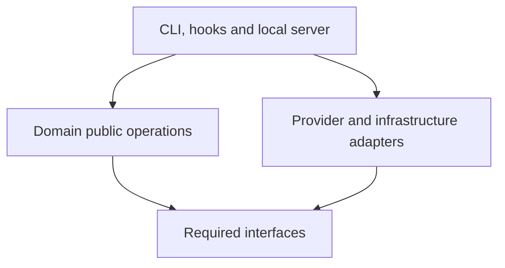

# Architecture and package boundaries

Weaver supervises the coding agents that work in a repository. Its target architecture is a monorepo with packages organized around explicit responsibilities and applications that assemble those packages.

This document records the proposed extraction structure. These packages and applications have not been implemented. Package boundaries must be checked against actual dependencies and observable behavior before their contracts are finalized.

## Repository structure

| Path                        | Purpose                                                     |
| --------------------------- | ----------------------------------------------------------- |
| `apps/cli/`                 | Commands for the project owner.                             |
| `apps/hooks/`               | Agent event entry points and enforcement of decisions.      |
| `packages/agent-sdk/`       | Agent runtime ports and provider adapters.                  |
| `packages/project-context/` | Project instructions, sources and scope resolution.         |
| `packages/action-control/`  | Action permission evaluation.                               |
| `packages/sessions/`        | Task lifecycle, observed changes and work tracking.         |
| `packages/validation/`      | Checks, reviews and task completion requirements.           |
| `packages/memory/`          | Qualified project knowledge and explicit recall mechanisms. |
| `packages/persistence/`     | Shared durability and storage primitives.                   |
| `docs/`                     | Architecture, contracts and development documentation.      |

This structure first held a web workbench, a local server under `apps/workbench/server/` and a client in the browser under `apps/workbench/web/`. The owner cancelled it on 2026-10-13 for an interface in the terminal, `weaver ui`, which lives in `apps/cli` beside the commands it stands for.

Start with coordinated releases and private workspace packages. A package boundary does not require a separate service, process or independently published version.

## Package responsibilities

| Package           | Owns                                                                                                                   | Boundary                                                                                   |
| ----------------- | ---------------------------------------------------------------------------------------------------------------------- | ------------------------------------------------------------------------------------------ |
| `agent-sdk`       | Runtime communication, normalized events, interruption and capability discovery, including model and effort options.   | Does not decide project policy or completion requirements.                                 |
| `project-context` | Loading declared project instructions, resolving their scope and supplying applicable sources to agents and reviewers. | Does not judge whether code complies with those instructions.                              |
| `action-control`  | Interpreting requested actions, evaluating permissions and producing explained decisions.                              | Does not judge the quality of the work.                                                    |
| `sessions`        | Task lifecycle, change attribution, snapshots, progress and session records.                                           | Does not own validation rules or project knowledge.                                        |
| `validation`      | Check execution, observed outcomes, independent reviews, findings and completion requirements.                         | Uses requirements and tools declared by the project.                                       |
| `memory`          | Subjects, descriptions, sources, evidence, qualifications, relationships and recall policies.                          | Does not replace project instructions or treat a retained statement as verified execution. |
| `persistence`     | Transactions, locks, journal primitives and content-addressed blobs.                                                   | Does not own the business schemas or lifecycle rules of other packages.                    |

Each domain owns its data model and public operations. Consumers use those operations rather than importing another package's internal files. Shared storage mechanisms do not imply a single semantic journal for sessions, conversations and memory.

## Agent SDK: ports and adapters

All provider integrations live in one SDK. Provider names identify internal adapters rather than separate packages.

| SDK path                     | Role                                                                    |
| ---------------------------- | ----------------------------------------------------------------------- |
| `agent-sdk/ports/`           | Focused contracts for conversation, execution and capability discovery. |
| `agent-sdk/adapters/codex/`  | Translation of the Codex runtime protocol into those contracts.         |
| `agent-sdk/adapters/claude/` | Translation of the Claude runtime protocol into those contracts.        |
| `agent-sdk/testing/`         | Test adapters and shared contract fixtures.                             |

Ports describe the operations consumers need. Adapters translate provider-specific events, requests and failures. Avoid a single provider interface that forces every adapter to pretend it supports every operation.

Provider differences remain explicit. Unsupported operations have an unavailable capability and an explanation. Model and effort choices come from supported provider capabilities; project configuration and permissions determine which available choices can be used.

## Project rules and context

The consuming project owns its development conventions, instruction documents, permissions, validation tools and retained data. Weaver owns the mechanisms that load, apply and verify them.

| Project requirement                                     | Weaver responsibility                                                             |
| ------------------------------------------------------- | --------------------------------------------------------------------------------- |
| Backend, frontend, SQL and documentation conventions    | `project-context` loads the declared sources and selects applicable instructions. |
| Protected paths and permitted agent actions             | `action-control` evaluates requests against configured permissions.               |
| Test commands, check thresholds and review requirements | `validation` runs applicable checks and evaluates completion requirements.        |
| Project history, evidence and retained decisions        | `memory` manages qualified records under explicit recall policies.                |

`project-context` is the configurable integration point for project instructions. Its adapters read declared sources, initially local files. The project declares each source's scope and intended audience, such as the working agent or independent reviewer.

For example, a frontend convention document can apply to changes under a frontend directory and be supplied to both the agent and reviewer. A related automated check is declared separately in validation configuration. Loading a convention does not make it mechanically enforceable.

The instruction declaration format is still to be designed. This document establishes its responsibilities, not a supported configuration syntax.

For a backend change, project-context supplies the applicable conventions, action-control evaluates attempted actions, sessions records the observed changes, and validation uses the relevant tools and review criteria. Each result retains enough source information to explain which requirement was applied.

Project permissions, development instructions and completion requirements are distinct contracts. There is no generic `project-policy` package responsible for interpreting all three.

## Responsibilities, features, capabilities and configuration

| Concept             | Meaning                                            | Example                                        |
| ------------------- | -------------------------------------------------- | ---------------------------------------------- |
| Responsibility      | Ownership of behavior and state.                   | Validation owns the review lifecycle.          |
| Feature             | An operation exposed to the user.                  | Request an independent review.                 |
| Capability          | A mechanism available in the current environment.  | An available provider can execute that review. |
| Configuration       | A selected value controlling supported behavior.   | Model, effort and resource budget.             |
| Project requirement | A condition or restriction imposed by the project. | A review is required before completion.        |

Each package defines and validates its own configuration. Applications assemble the effective configuration and present it. Configuration resolution must retain the source of a value and explain unavailable or restricted capabilities.

Installation, project and session settings have explicit precedence and override rules. A session choice cannot weaken a project obligation. Availability, enabled state, selected configuration and authorization must remain distinguishable.

Automatic recall triggered by a file change and recall triggered by a user request are separate capabilities with separate contracts. Extraction must not silently replace one with the other.

## Application composition and dependency direction

The CLI, hooks and local server assemble domain operations and their adapters. They coordinate workflows without reimplementing domain rules. The browser invokes server APIs and does not import storage implementations or native agent execution code.

Domain packages define the interfaces they need from external systems. Infrastructure and provider adapters implement those interfaces where appropriate. Concrete implementations are selected at application composition points.

This diagram shows architectural roles and dependency direction rather than a complete package import graph. Arrows mean that the source depends on the target contract.

Public server API contracts must be usable by the browser without bringing in Node.js dependencies. Their exact package placement remains to be decided when the API is defined; this proposal does not add a generic contracts package in advance.

Shared resource scheduling, process execution and Git inspection also need explicit ownership during extraction. They must not be assigned to sessions or persistence merely because those packages already exist. The dependency inventory will determine whether they belong in focused internal modules or warrant another package.

## Extraction and acceptance

Develop Weaver separately while keeping the operational reference harness unchanged. Inventory behavior and project dependencies before moving implementations. Separate project requirements from reusable mechanisms and validate each extracted boundary with isolated fixtures.

For each package, define its owned state, public operations, permitted dependencies, failure behavior and independently testable scenarios. Check for circular dependencies and cross-package internal imports before finalizing contracts.

Restructuring preserves existing behavior unless a change is explicitly agreed. Correcting recall selection, changing memory schemas or modifying review policy are separate behavior decisions, not incidental effects of moving code.

Development and tests must not write to live project state alongside the operational harness. Historical data migration and engine replacement are separate operations. Adoption requires validated integration, preserved evidence, a selected version and a rollback procedure.
